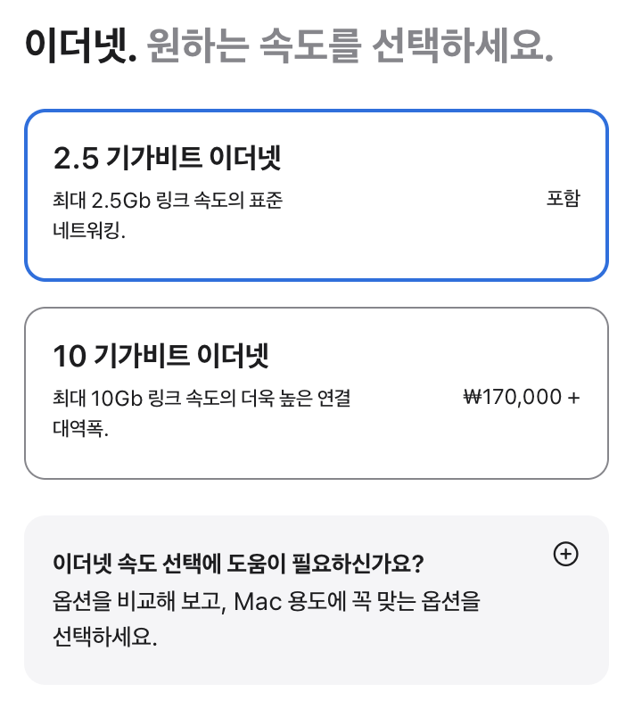
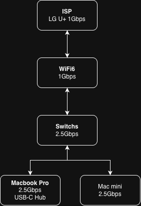
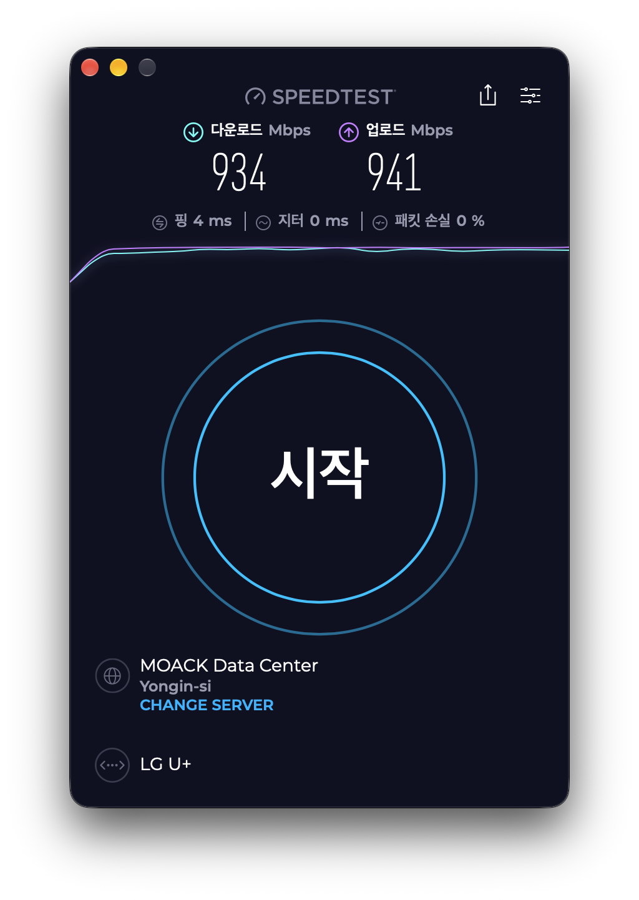
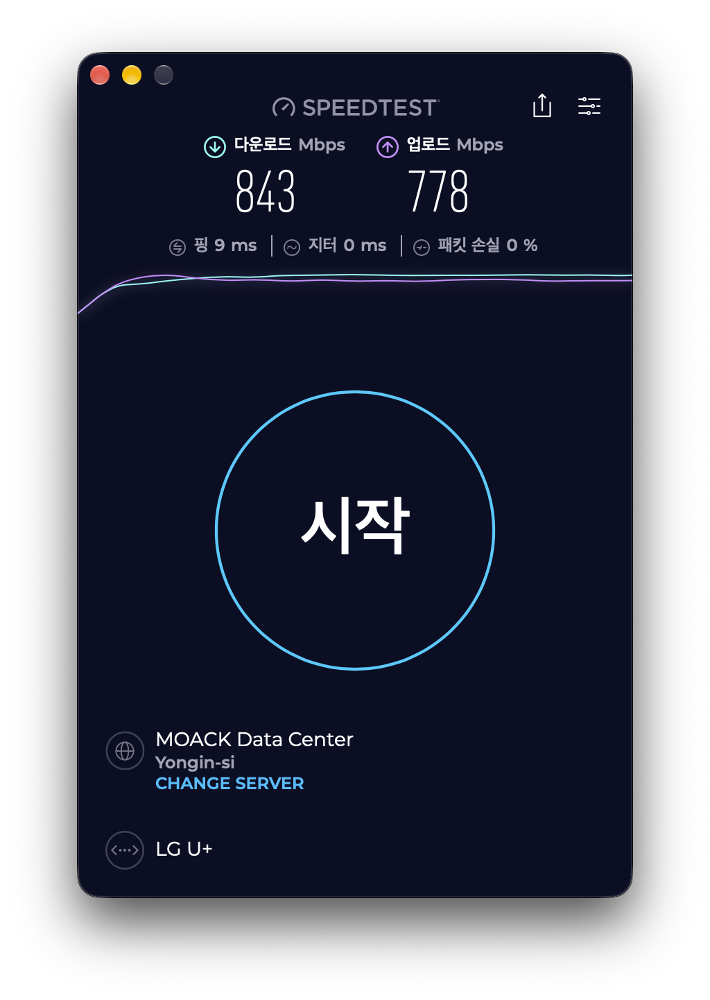
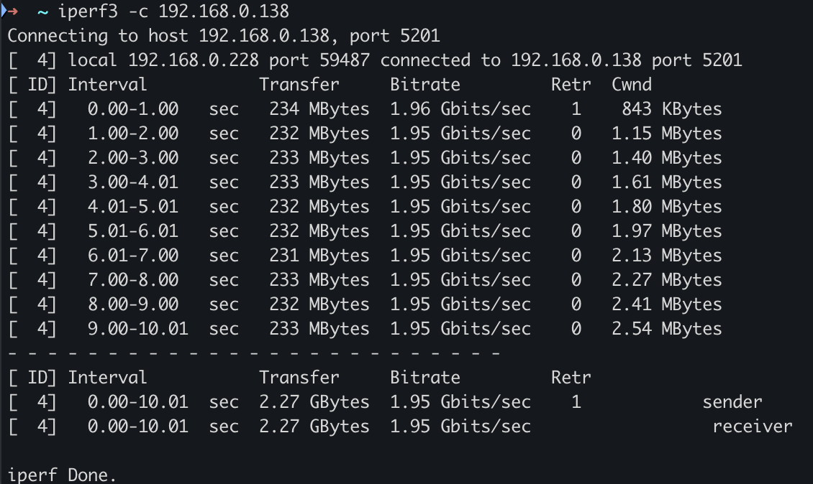
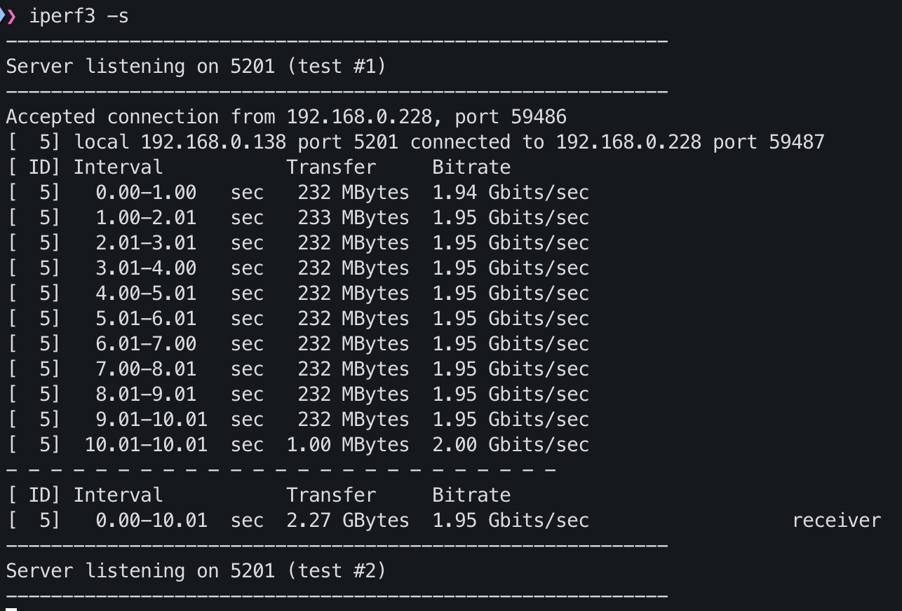

안녕하세요. 박현상입니다.  
맥 미니(M6)를 최근에 구매하게 되면서, 맥북 프로(M5)와 함께 2.5Gbps를 사용하면 좋을 것 같아서 집에 내부 네트워크를 구성하게 되었습니다.  

맥 미니(M6)에서 기본적으로 이더넷 포트에 2.5Gbps를 지원하게 되면서 맥북 프로(M5)를 함께 사용하면 좋을 것 같아서 본격적으로 구성하게 되었습니다.

## 필요한 준비물

**2.5Gbps를 지원하는 하드웨어가 필요합니다.**

- LAN 케이블 - CAT.7 이상 2.5Gbps를 지원하는 LAN 케이블 필요합니다.
    - 저는 CAT.8 LAN 케이블을 사용하였습니다. [코드웨이 CAT.8 랜선 초고속 인터넷 랜케이블](https://www.coupang.com/vp/products/7246392402)를 사용했습니다.
- USB-C Hub 혹은 USB-C LAN 케이블 어뎁터가 필요합니다.
    - 저는 USB-C Hub에서 2.5Gbps를 지원하는 [belkin INC009bt](https://www.belkin.com/kr/p/usb-c-7-in-1-%EB%A9%80%ED%8B%B0%ED%8F%AC%ED%8A%B8-%EC%96%B4%EB%8C%91%ED%84%B0/INC009btSGY.html)를 사용했습니다.
- 스위치 혹은 Wi-Fi 공유기가 필요합니다.
    - 저는 스위치를 사용했습니다. [티피링크 TL-SG105S-M2](https://www.tp-link.com/kr/business-networking/unmanaged-switch/tl-sg105s-m2/)를 사용했습니다.
- 공유기의 경우에는 선택 사항입니다. WAN을 직접 연결하셔서 사용하셔도 되지만 통상적으로 와이파이가 필요한 경우가 있기 때문에 저는 와이파이 공유기를 거친 다음에 스위치로 연결하였습니다. 

## 전반적인 네트워크 구성도

1. ISP(LG U+ / KT 등) - 1Gbps
2. Wi-Fi 공유기 - 1Gbps
3. 스위치 - 2.5Gbps
4. 맥 미니 / 맥북 프로(USB-C Hub) - 2.5Gbps

## 외부망 · 내부망 속도 테스트

### 외부망

저는 LG U+ 1Gbps의 인터넷망을 사용하고 있습니다. 속도 측정을 해보니 거의 비슷한 속도로 나오는 것을 볼 수 있습니다.

- 상단 - 맥 미니
- 하단 - 맥북 프로

### 내부망

맥북에서 서버를 열었고 맥 미니에서 연결 테스트한 결과는 위와 같습니다.  
생각보다 잘 나와서 놀랐습니다. 외부적인 요인을 고려한 결과 정상적인 속도라 생각됩니다.  
추후에 1시간 정도 테스트를 거친 다음에 속도가 어떤지도 확인할 예정입니다.

## Ref

- [[PC] 2.5G 내부 네트워크 구성 | 2.5G 스위치, 2.5G USB 랜카드 구매](https://blog.naver.com/an2gen3/223738880271)